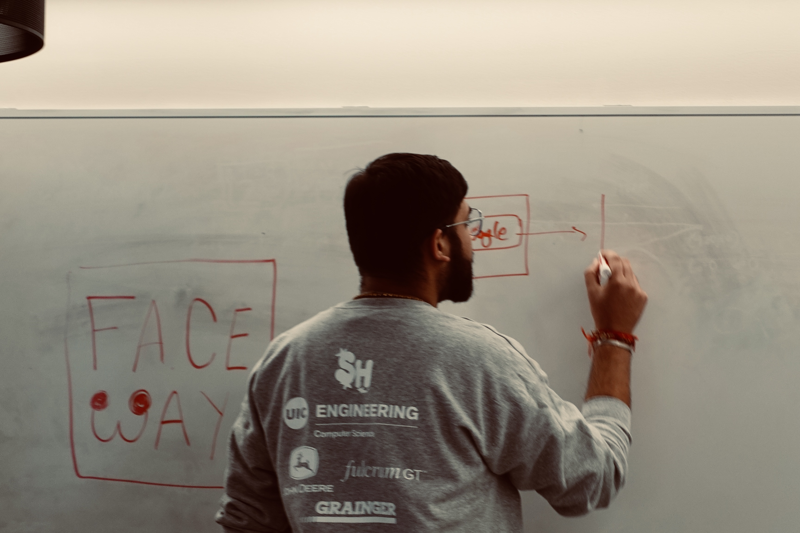

  

<i>Hackathon brainstorming session</i>

# Hi, I'm Kirtan Patel

CS grad student at UIC (MS, Dec 2026) working at the intersection of AI security, adversarial testing, and full-stack systems. I build things that are meant to break other things — and things that are meant to hold up when attacked.

---

## 🔍 Current Focus

- Building **LLM red-team pipelines** — automating jailbreak attack strategies, judge-scoring outputs on HarDBench, and training defensive monitors evaluated against AdvBench
- Implementing **cryptographic protocols from scratch** — Tor's onion routing, AES-256-GCM, X25519 Diffie-Hellman, HKDF, all verified against NIST/IETF test vectors
- Developing **diff-aware security tooling** for catching vulnerabilities before they hit production
- Building a **GPS-free embedded navigation system** using sensor fusion (pressure, magnetometer, IMU)

---

## 🛠️ What I Work With

**AI & Red Teaming**

**Full-Stack**

**Data & Infrastructure**

---

## 📌 Pinned Projects

**[Red_Co-Author](https://github.com/kirtanpatel2003)** — LLM red-team + defensive monitor stack targeting the Co-Authoring Jailbreak (CoJP) vulnerability. Two-armed attack pipeline, HarDBench judge scoring, scikit-learn monitor evaluated on AdvBench and HarDBench splits. `Python` `Ollama` `Streamlit` `scikit-learn`

**[Curio](https://github.com/urban-toolkit/curio)** — Credited open source contributor. Built the real-time multi-device collaboration layer for Curio, a dataflow framework for urban visual analytics. Live presence, per-node soft locks, accept/decline proposals with first-accept-wins conflict resolution. Ships in the released codebase. `Python` `Flask` `Socket.IO` `React` `TypeScript`

**[Mini Tor Anonymity Network](https://github.com/kirtanpatel2003)** — Three-hop onion routing from scratch. Six independent processes over real TCP. Entire crypto stack in pure Python — SHA-256, HMAC, HKDF, X25519 via Montgomery ladder, AES-256-GCM — verified against NIST/IETF test vectors.

**[DiffFence](https://github.com/kirtanpatel2003)** — Diff-aware security gate that scans code changes for vulnerabilities via OSV.dev and a local LLM before push or merge. Baseline logic surfaces only new findings.

---

## 💬 Ask Me About

- LLM adversarial testing — jailbreak pipelines, attack-success-rate evaluation, defensive monitors
- Cryptographic protocol implementation — onion routing, AES-GCM, Diffie-Hellman, HKDF from scratch
- Full-stack development — React, Node.js, Next.js, MongoDB, REST APIs
- Security tooling — diff-aware scanning, audit logging, access control design
- Local LLM orchestration with Ollama

---

## 📬 Reach Me

**Email:** [official.kirtan13@gmail.com](mailto:official.kirtan13@gmail.com)
**LinkedIn:** [linkedin.com/in/patelkirtan13](https://www.linkedin.com/in/patelkirtan13/)
**Portfolio:** [patelkirtan.com](https://patelkirtan.com)
